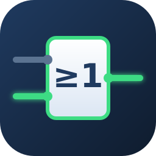
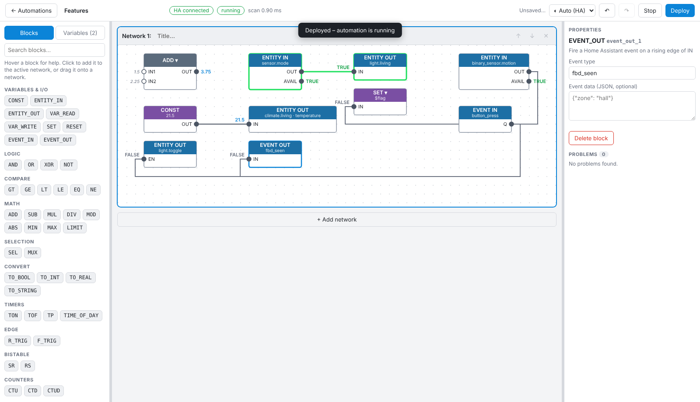

<p align="center"></p>

# FBD Automation for Home Assistant

Program your Home Assistant automations as **IEC 61131-3 function block diagrams** – the way you would in TIA Portal or CODESYS: stacked *networks*, function blocks wired left → right, internal variables, and a PLC-style cyclic scan (default every 100 ms).



## Features

- **TIA-Portal-style editor** inside Home Assistant (Ingress / sidebar): stacked networks, drag-to-wire, type-checked pins, undo/redo, copy / cut / paste, multi-select, right-click menu, resizable panels, light / dark theme (follows Home Assistant).
- **Live view:** while an automation runs, active wires and blocks turn green and the current value is printed on every wire.
- **45 blocks:** logic (AND/OR/XOR/NOT), comparisons, math, selection, conversion, timers (TON/TOF/TP, time of day), edge detection, flip-flops, counters – see the [block reference](docs/BLOCKS.md).
- **Home Assistant I/O:** read entity states or attributes, switch entities, set values or attributes, call services, send and receive events, switch a whole **room** (area) on or off.
- **Internal variables** shared between networks and carried over between scans (feedback, state machines).
- **Several automations**, each with its own program, variables and scan loop; start / stop / duplicate individually.
- **Deterministic engine:** variables are read at the start of a scan and written at the end; outputs only fire on change or on a rising edge.

| Automations | Room switching with SET / RESET |
|---|---|
|  |  |

## Quick start

1. Copy `dist-addon/ha_fbd` (see [installation](docs/INSTALL.md)) to the Samba share **addons** of your Home Assistant.
2. *Settings → Add-ons → Add-on Store → ⋮ → Check for updates*, then install **FBD Automation** under *Local add-ons*.
3. Start it and enable *Show in sidebar*.
4. Click **+ New automation**, build a program, press **Deploy**.

Full walkthrough: [docs/INSTALL.md](docs/INSTALL.md) · [docs/USER-GUIDE.md](docs/USER-GUIDE.md)

## Documentation

| Document | Content |
|---|---|
| [INSTALL.md](docs/INSTALL.md) | Install as local add-on (Samba/SSH), options, updating, troubleshooting |
| [USER-GUIDE.md](docs/USER-GUIDE.md) | The editor, building programs, examples, live view |
| [BLOCKS.md](docs/BLOCKS.md) | Reference of every block, pin and parameter (generated) |
| [ARCHITECTURE.md](docs/ARCHITECTURE.md) | Engine, scan cycle, server, editor, file formats, REST API |
| [DEVELOPMENT.md](docs/DEVELOPMENT.md) | Develop and test on your PC, browser tests, adding a block |
| [CHANGELOG.md](CHANGELOG.md) | Version history |

## Repository layout

```
packages/engine   pure TypeScript FBD engine (blocks, compiler, scan cycle) – no HA dependency
packages/server   HA websocket client, program host, REST + SSE API
packages/editor   React + SVG editor (esbuild bundle served by the server)
addon/ha_fbd      Home Assistant add-on definition (config.yaml, Dockerfile, docs, icon)
scripts           package-addon.mjs, gen-block-docs.ts
docs              documentation and screenshots
```

## Status

Tested on a real Home Assistant OS installation as a local add-on. The unit tests and browser end-to-end tests run against a fake Home Assistant. Issues and feedback are welcome.

## License

MIT – see [LICENSE](LICENSE).
