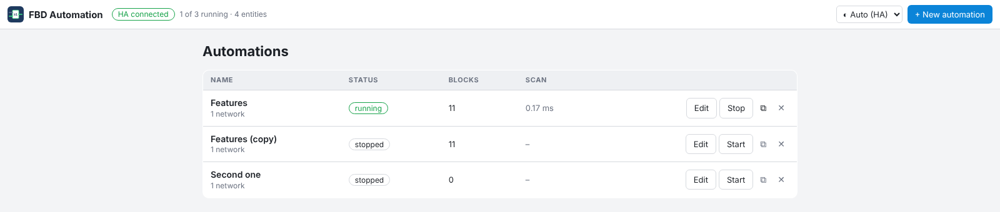
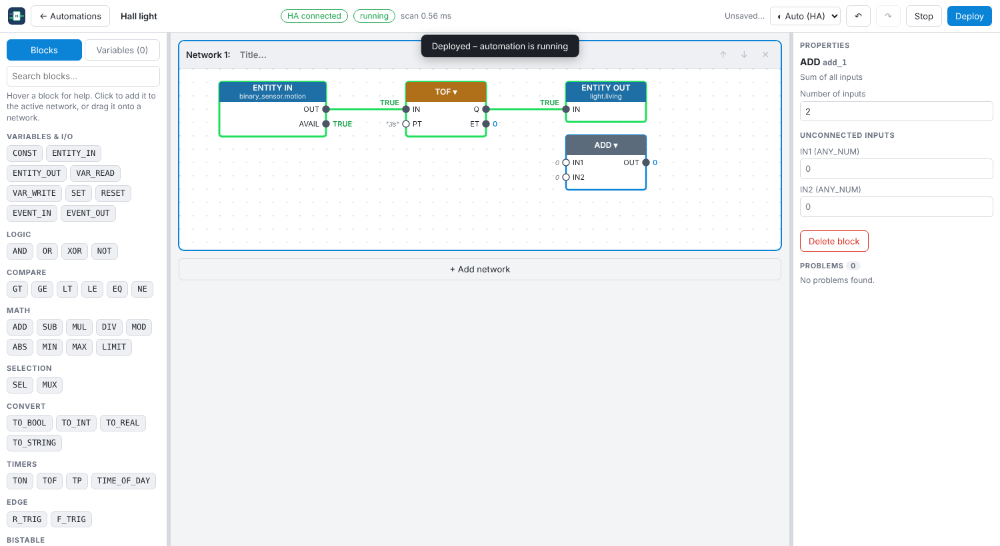
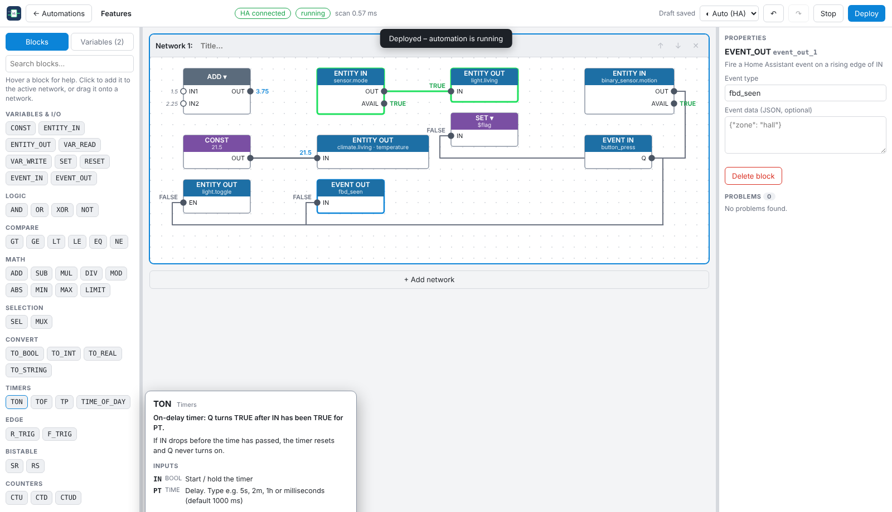
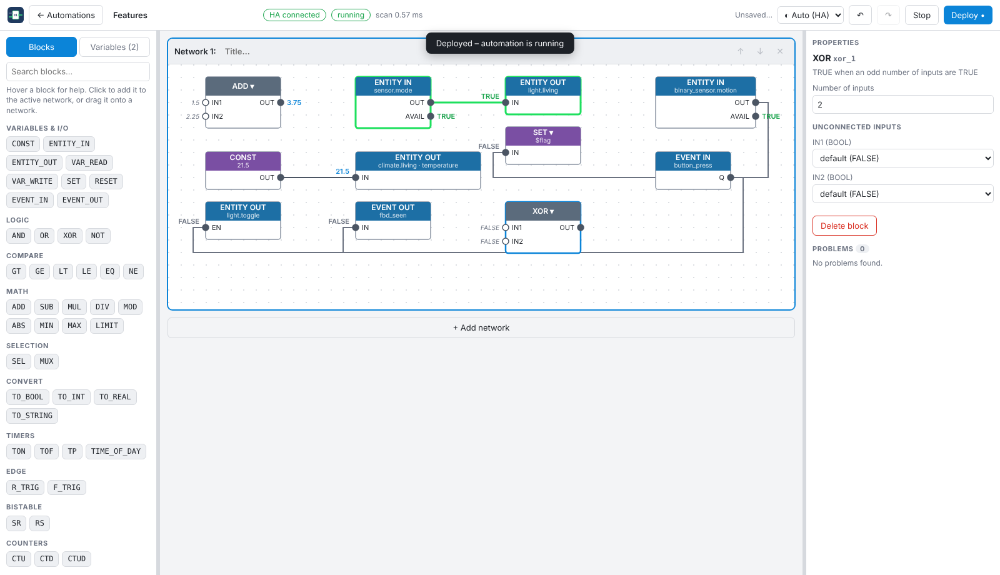
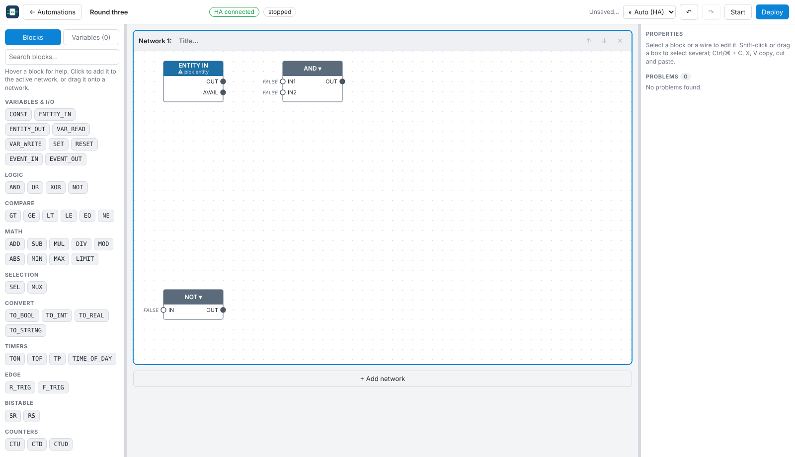
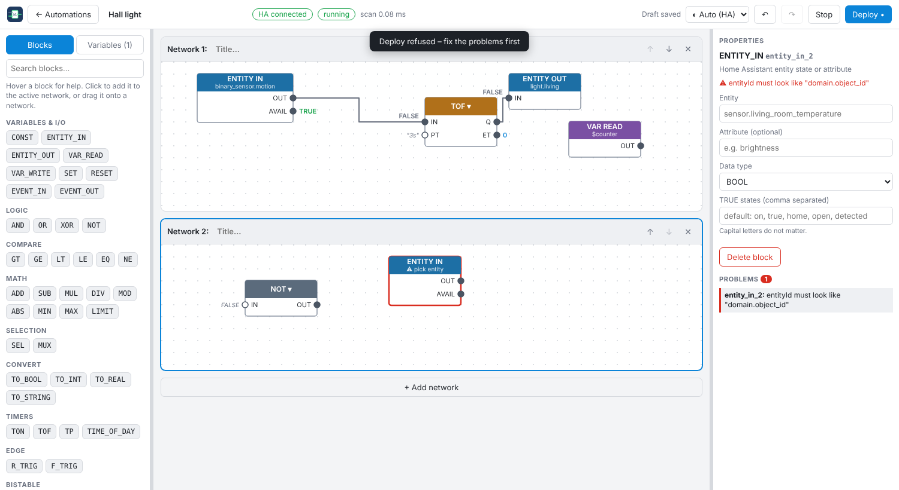
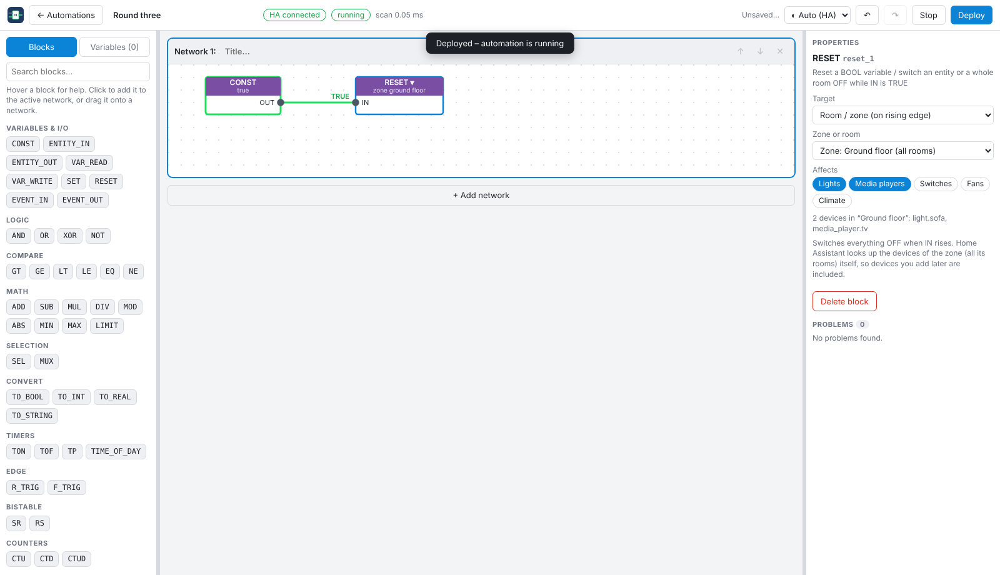
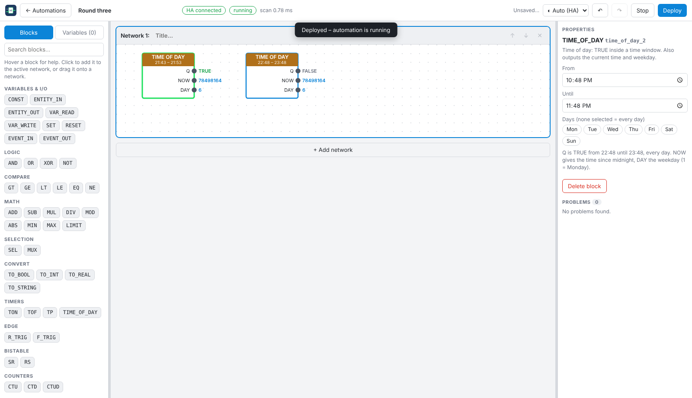
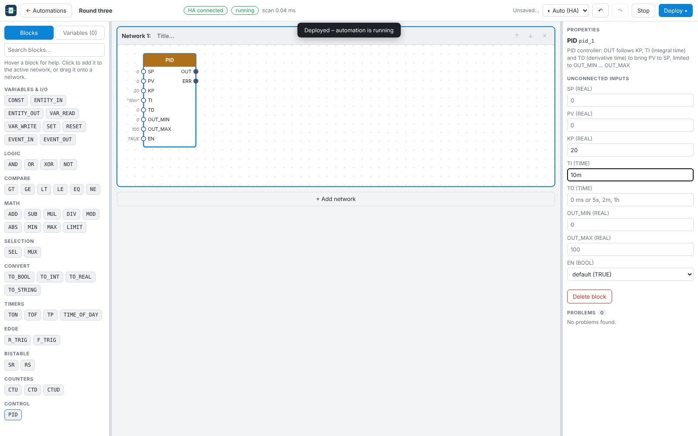
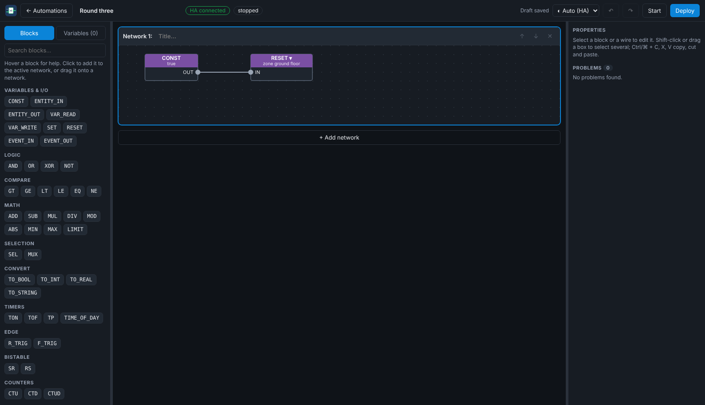

# User guide

## Concepts

| Concept | Meaning |
|---|---|
| **Automation** | One program with its own variables and scan loop. Start / stop / duplicate individually on the start page. |
| **Network** | A horizontal strip of blocks and wires, stacked vertically like in TIA Portal. Networks run top to bottom; blocks inside run in data-flow order. |
| **Block** | A function (AND, TON, ENTITY_IN …) with typed input and output pins. |
| **Wire** | Connects one output pin to one input pin. An input has at most one wire. |
| **Variable** | Named value (BOOL, INT, REAL, STRING, TIME) shared between networks. Values are read at the start of a scan and written at the end, so a variable also carries state to the next scan. *Local* variables reset when the automation starts; *retain* variables survive a restart. |
| **Scan** | The program is evaluated every `scan_ms` (default 100 ms), like a PLC cycle. Inputs are read from the Home Assistant state cache, outputs are sent at the end of the scan. |

Wires never form a loop inside one scan – use a **variable** for feedback (write it in one place, read it in another).

## The start page

Create a new automation, start or stop it, duplicate it or delete it. The header shows whether Home Assistant is connected.

**Export / import.** *Export all* exports every automation as one `.fbd.json` file; the ⭳ button on a row exports just that automation. The file is downloaded and the same content is shown as text: the Home Assistant apps ignore downloads from an add-on panel, so there you use *Copy text* instead. *Import* takes an export file or pasted text and adds the automations as **new, stopped** automations – nothing is overwritten, so importing the same export twice gives you copies. An export holds the programs only: whether an automation was running and the current values of its variables are not included. Use it as a backup or to move automations to another installation.

## The editor

- **Left:** *Blocks* (palette with search) and *Variables*. Hover a block for its documentation.

  
- **Middle:** the networks. **Right:** properties of the selected block, plus a list of problems found while compiling.
- **Top:** status (*HA connected*, *running*, scan time), theme, undo / redo, **Start/Stop** and **Deploy**.

### Building
- **Add a block:** click it in the palette (placed in free space of the active network) or drag it onto a network.
- **Wire:** drag from an output pin to an input pin. Compatible inputs light up; incompatible types are refused. A new wire replaces the old one.
- **Constants:** an unconnected input is a constant – edit it in the properties panel (`PT = 5s`, decimals as `1.5` or `1,5`).
- **Change block type:** click the block's name (e.g. *AND ▾*) to switch within its family (AND/OR/XOR/NOT, comparisons, math, timers, counters …). Wires and constants are kept where the pin still exists.

  
- **Select several:** shift / ⌘ / ctrl-click, or drag a box. **Ctrl/⌘ + C / X / V** copy, cut and paste; **Ctrl/⌘ + A** selects all; **Delete** removes; **Ctrl/⌘ + Z / Y** undo / redo.
- **Right-click** a block or the canvas for copy, cut, paste here, delete and select all.

  
- Side panels can be resized (double-click a handle to reset). Drafts are saved automatically.

### Deploying and the live view
**Deploy** validates the program, saves it and (re)starts the automation. Problems are listed (and the offending block marked) instead of starting a broken program.

While it runs, wires and blocks that are TRUE turn green and values are printed above the wires.

## Talking to Home Assistant

| Block | Use |
|---|---|
| `ENTITY_IN` | Read an entity's state or one of its attributes as BOOL / INT / REAL / STRING. `AVAIL` is FALSE while the entity is unavailable (the last valid value is held). |
| `ENTITY_OUT` | *switch* (BOOL → on/off), *value* (REAL → e.g. brightness / setpoint), *attribute* (set a named attribute), *service* (call any service on a rising edge). |
| `EVENT_IN` / `EVENT_OUT` | Receive a Home Assistant event (one-scan pulse, optionally a field of the data) / fire an event on a rising edge. |
| `SET` / `RESET` | Target **variable** (latch TRUE / FALSE), **entity** (switch on / off on a rising edge) or **room** (see below). |
| `TIME_OF_DAY` | TRUE inside a time window (also past midnight, optionally only on chosen weekdays) in Home Assistant's time zone. Also gives the current time and weekday. |

### Switch a whole room
Use **SET** or **RESET** with target **Room / zone**: choose a **zone** (a Home Assistant floor – the dropdown lists each zone with its rooms indented below it) or a single room, and which kinds of devices are affected (lights, media players, switches, fans, climate). RESET switches everything off, SET on – on a rising edge of `IN`. Home Assistant resolves the room or zone itself, so devices you add later are included. Rooms are managed under *Settings → Areas, Labels & Zones*; assign rooms to a floor there to make them show up under a zone.

### Time of day

`TIME_OF_DAY` sits in the **Timers** section. Use `R_TRIG` on its `Q` output to do something once at the start time.

## PID control

The `PID` block (palette section **Control**) keeps a measured value at a setpoint, for example a room temperature:

| Pin | Meaning |
|---|---|
| `SP` / `PV` | Setpoint (wanted) and process value (measured) |
| `KP` | Proportional gain. A negative value acts in reverse (cooling) |
| `TI` | Integral time (`10m`, `120s`, …). `0` = no integral part |
| `TD` | Derivative time. `0` = no derivative part (usually fine for room heating) |
| `OUT_MIN` / `OUT_MAX` | Output limits (default 0 – 100) |
| `EN` | `FALSE` resets the controller and holds `OUT_MIN` |
| `OUT` / `ERR` | Controller output and the error `SP − PV` |

**Example – floor heating valve:** `ENTITY_IN sensor.room_temp` → `PV`; `SP` = 21; `KP` = 20; `TI` = 15m; `OUT` → `ENTITY_OUT` of kind *value* on the valve position. Tune by raising `KP` until the response is quick but not oscillating, then add a long `TI` to remove the remaining offset. The integral part stops growing while the output sits at a limit (anti-windup), and the maths uses the real time between scans, so the scan interval does not change the behaviour.

## Themes
The theme selector (top right) is **Auto** (follows your Home Assistant light / dark setting), **Light** or **Dark**.

## Examples

**Motion light with off-delay**
`ENTITY_IN binary_sensor.motion` → `TOF` (PT = 3 min) → `ENTITY_OUT light.living` (switch).
The light follows the sensor and stays on 3 minutes after the last motion.

**Good-night button**
`EVENT_IN` (your button's event) → `RESET` target *Room* “Living room”, lights + media players.

**Only at night**
`ENTITY_IN` (motion) AND `TIME_OF_DAY` (22:00 – 06:00) → `ENTITY_OUT` (light).

**Latch with a variable**
Doorbell → `SET` variable `visitor`; “visitor seen” → `RESET` variable `visitor`; read it anywhere with `VAR_READ`.

See [BLOCKS.md](BLOCKS.md) for every block.
